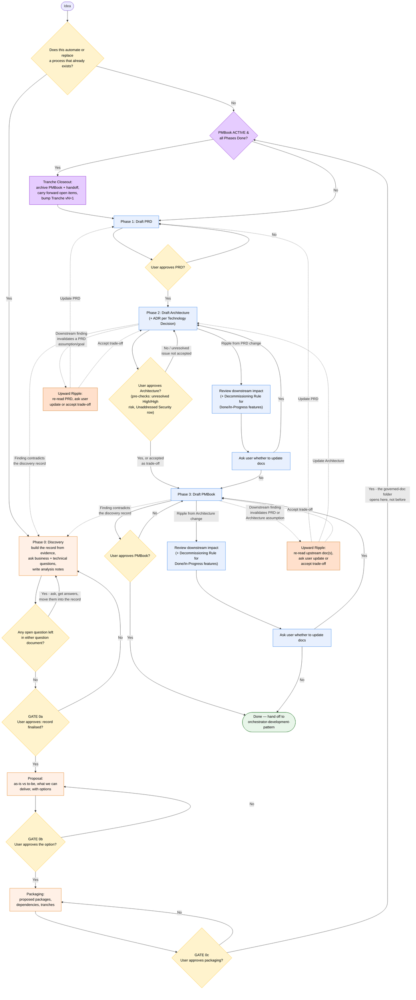

# Idea Triage Flow

**Notes:**
- Solid arrows are the normal forward path and downward ripple (PRD → Architecture → PMBook). Dashed arrows are Upward Ripple — a downstream finding (most often an Architecture-phase research spike, but PMBook triage can trigger it too) that invalidates an upstream goal, non-goal, constraint, or assumption. Upward Ripple never applies to a routine technology choice that stays within what the PRD already scoped.
- `TrancheCheck` runs at the start of every triage session when new ideas are presented, not just on an explicit "close out" request — see Tranche Lifecycle.
- `G2`'s pre-checks (unresolved `Impact: High` + `Likelihood: High` risk row, or an `Unaddressed` Security & Compliance Checklist row when §9 is present) are soft gates: surface and ask, never silently block or silently pass.
- Every document change on every edge above increments that document's `Version` and adds a `Version History` row labeled `Triage edit`, `Gate approval`, `Ripple from <Doc> vN`, `Upward ripple from <Doc> vN`, or `Tranche closeout`, per the Versioning rules.
