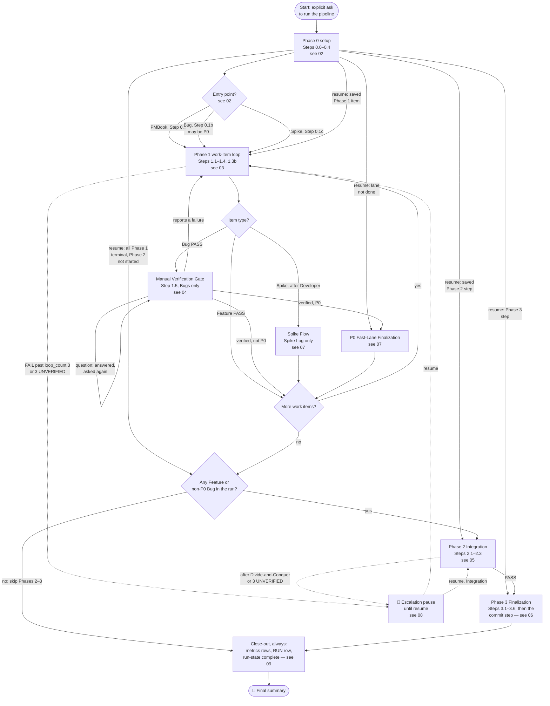

# 01 — Bird's-eye view

The whole run on one page. Each node names its step and the file that draws it in detail.
Hexagons are sub-agent spawns; diamonds are decisions; dotted edges lead to a human pause.

`run-state-file` is saved when each step starts and ends, at every verdict and every user decision, so an
interrupted run can be resumed from Step 0.0 (order in 02); a step found `started` re-runs from its start.
The commit (per `decisions.commit`) is the last step inside Phase 3 and inside each P0 lane, before
close-out; a resumed lane carries on through More to the remaining items. A fast-laned P0 counts as finalized: it does not by itself send the run to Phase 2. When Phase 2 runs, it
waits for every P0 lane to finish and re-validates each fast-laned P0 as a Deferred ID.
