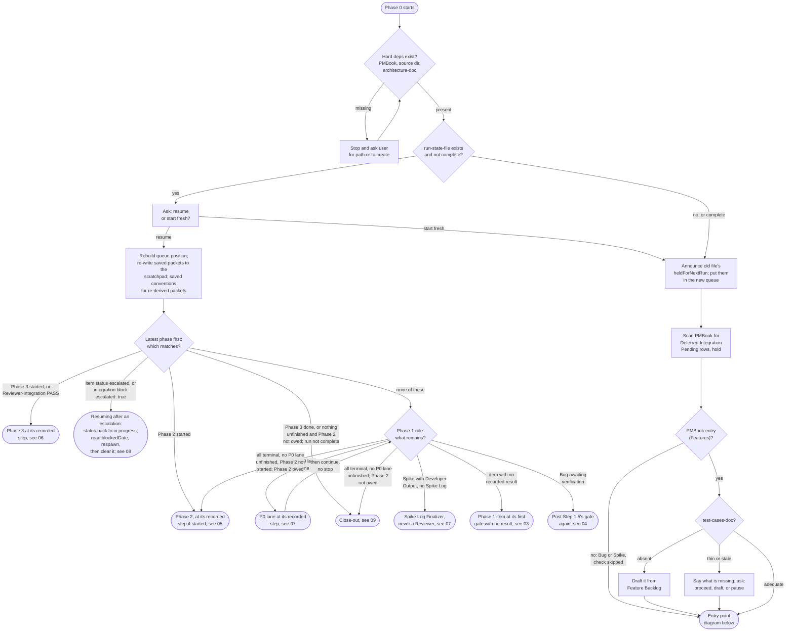
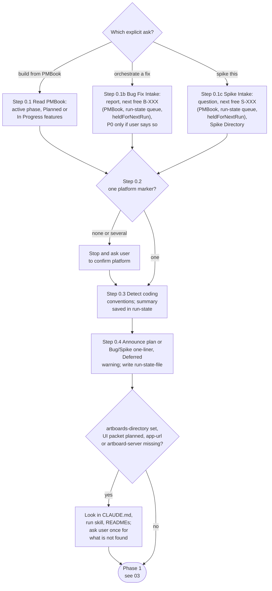

# 02 — Phase 0: setup

Two diagrams: the Step 0.0 checks in their stated order, then the entry point and plan
(Steps 0.1–0.4).

## Step 0.0 — hard dependencies, resume, deferred integration, test cases

Soft dependencies (`handoff-doc`, `changelog-file`, `revision-file`, `test-runbook-location`,
`snyk-command`, `adr-directory`, `graphify-directories`, `run-state-file`, `metrics-log-file`) are never
asked about here; each is created or used where its step needs it. On a Bug or Spike entry, Step 2.1
passes `test-cases-doc` if it exists, else "None provided".

## Steps 0.1–0.4 — entry point, platform, conventions, plan

Bug and Spike intake replace the feature list in the Step 0.4 announcement with one line
(`Bug Fix Mode [P0] — B-XXX: …` / `Spike Mode — S-XXX: …`) and still print the Deferred Integration
warning and write `run-state-file`. A bug or spike asked for while a run is open is a mid-run intake
instead: same run id and run-state file, appended to the queue (or, once Phase 2 has started, saved in
`decisions.heldForNextRun` to seed the next run's queue). The run id is `<YYYY-MM-DD>-<first item id, lowercased>-<HHmm>` (start time), with `-2`, `-3`… if
`metrics-log-file` or `git log --grep "Run-Id: <id>"` already has it. A design
mismatch reported at Step 0.1b on a built screen is noted at intake and recorded in `metrics-log-file`
only after Step 0.4 has created run-state and saved the event time — see 09.

On resume, a step found `started` (not `done`) re-runs from its start; the rest of Phase 0 is skipped.
A P0 lane resumed at its recorded step does not end the resume: the Phase 1 rule carries on for the
remaining items, and once all are terminal (a Feature `passed review`, a Bug `verified`, a Spike `findings
recorded`, or any item `dropped`; and no P0 lane unfinished) Phase 2's entry rule picks Phase 2 or close-out. These
rules read each item's run-state `status` (`in progress | passed review | awaiting verification |
verified | findings recorded | escalated | dropped`, saved at each change); a `dropped` item is skipped,
and a Bug `awaiting verification` gets Step 1.5's gate posted again. Before any of
this, right after "run complete", an item with status `escalated` (or the `integration` block with
`escalated: true`) goes to **Resuming after an escalation** (08). Close-out is chosen early only when
Phase 3 is `done`, or nothing is left unfinished and Phase 2's entry rule says Phase 2 is not owed; a
Features run that crashed before Phase 2 falls through to the Phase 1 rule and so to Phase 2.
An old run-state's `heldForNextRun` packets (complete, or the user chose "start fresh") are announced
and join the new run's queue before Step 0.4 writes the new file, so the next-free-ID scan sees them.

"resume" means two things: here at Step 0.0 it picks an interrupted run back up; at an escalation (08) it
un-pauses the current run.
