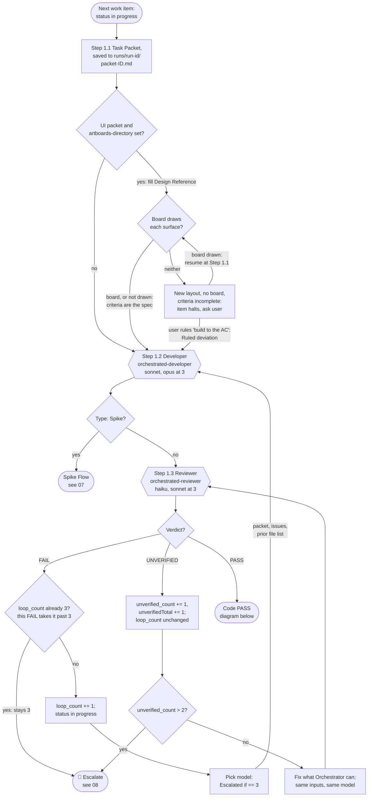
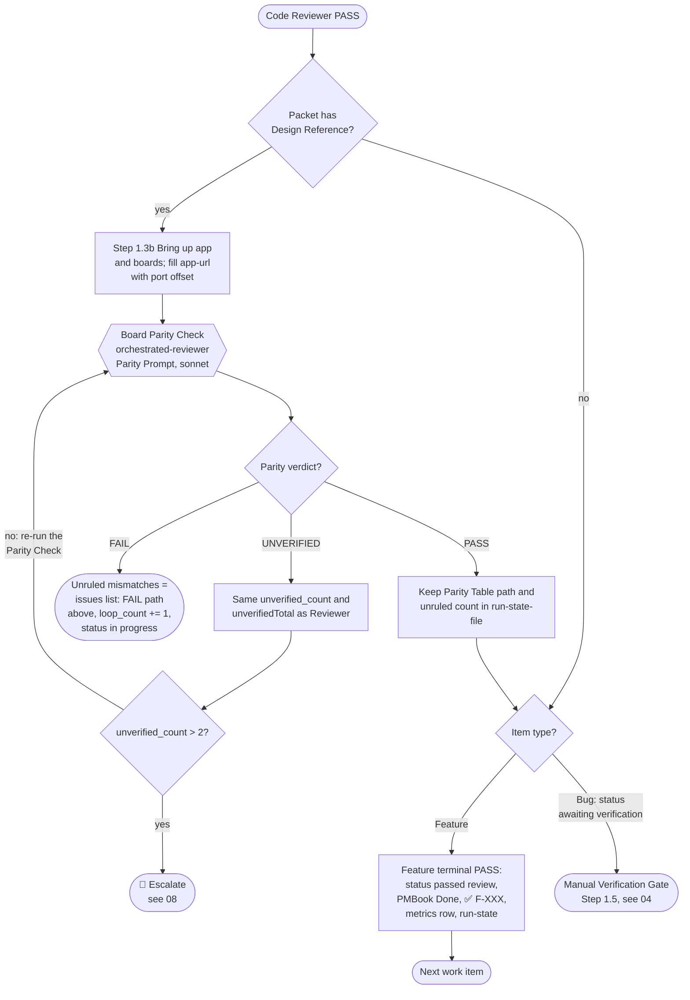
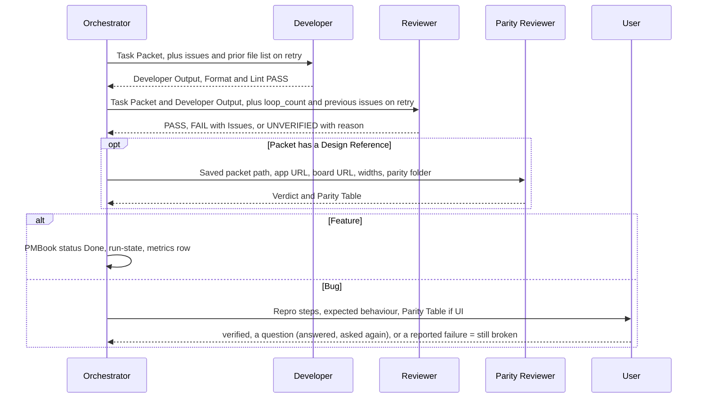

# 03 — Phase 1: the work-item loop

One work item at a time, in dependency order. `loop_count` starts at 0 per item. Models come from
SKILL.md's Model Assignment: base model at `loop_count` 1–2, Escalated Model at 3. `run-state-file` is
saved after every Developer return and every Reviewer or Parity verdict.

## Steps 1.1–1.4 — Developer, Reviewer, retries

On a retry the Reviewer also gets `loop_count` and the previous issues list (Step 1.4). A Bug packet's
Reviewer also runs the one regression test its `## Note on Tests` names (04). A packet the Orchestrator
added to (a Design Reference, a ruling) is stored in full in `run-state-file`.

## Code PASS → Board Parity Check → Done rules

A Parity FAIL retry goes Developer → code Reviewer → Step 1.3b again, under the same 3-strike rule; in
that retry's Reviewer Retry Context each parity issue is marked `verified by Step 1.3b, not by you`.
The Parity Check uses `sonnet` at every `loop_count`, and writes into
`<scratchpad>/parity/<run id>/<ID>[-legN][-retryN]/` (`-legN` from leg 2 on).

## Who sends what

