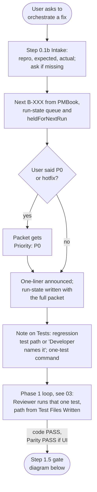
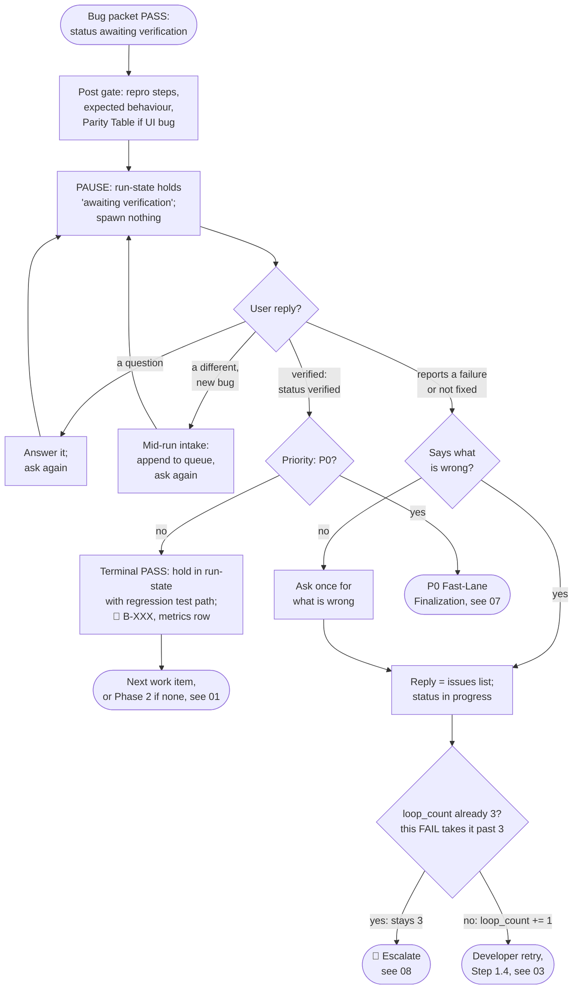

# 04 — Manual Verification Gate and the Bug path

## A Bug from intake to the gate

Several bugs at once run in the order given; two likely to touch the same files are said so and
serialized.

## Step 1.5 — Manual Verification Gate

A question is answered and the gate asked again; it is not a rejection. Nor is a report of a different
bug: that is a mid-run intake (same run, appended to the queue). A rejection is handled the same whether or not the Bug is P0; the fast lane only changes what follows a
genuine "verified". Features never pass through this gate. Step 3.2 writes a non-P0 Bug's `## Bug Log`
row with Status `Fixed` and the regression test path in its Description (06).
