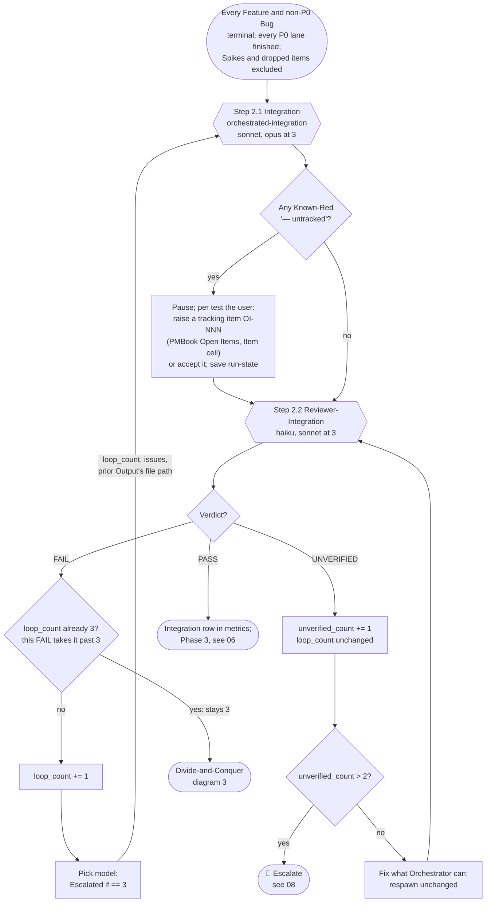
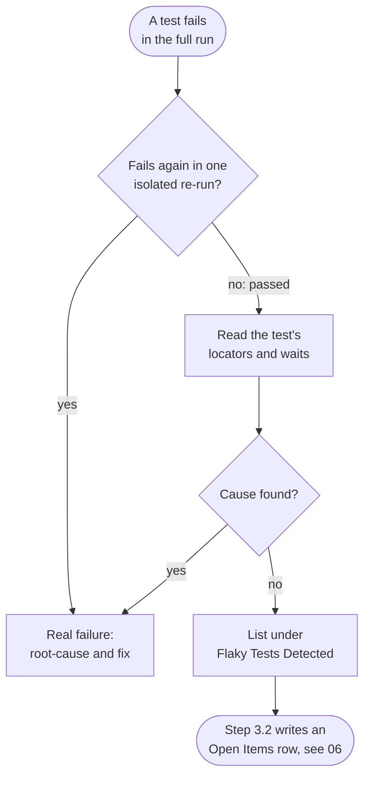
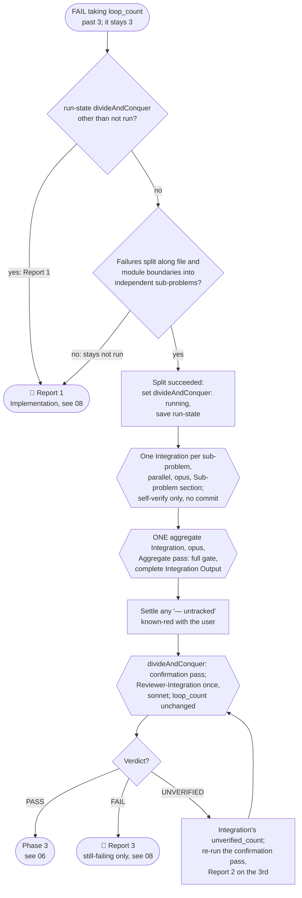

# 05 — Phase 2: Integration

Three diagrams: the Integration loop (Steps 2.1–2.3, Known-reds), how a failing test is triaged (flaky
rule, Enforcement Rules), and Divide-and-Conquer (`references/escalation.md`). Skipped entirely when the
run holds no Feature and no non-P0 Bug (01).

## Steps 2.1–2.3 — Integration loop

The Integration Agent gets paths, never file contents: Platform Profile, completed Features and Bugs,
`source-code-directory`, a Module Map of "None" (a known-red's owner is the top-level folder or module
holding the test), `test-cases-doc`, `architecture-doc`, PMBook, `test-runbook-location`,
`adr-directory`, Pending Deferred Integration IDs with their regression test paths (re-read from the
PMBook at Step 2.1, so this run's fast-laned P0s are among them), and the
`## Accepted Known-Reds` and `## Known Reds at Baseline` lines (Step 0.3b; both on every retry and
Divide-and-Conquer spawn). A test red at baseline and still red goes under Known-Reds, not into flaky
triage as new; a test green at baseline and red now is this run's. It runs the full
suite, fixes failures, runs the security audit and E2E/smoke tests, and checks Documentation Drift, which
is a FAIL-worthy defect. It fixes code, never the test-cases doc: each gap there is handed to the Test
Runbook Finalizer (Step 3.5) as a `— handed to Test Runbook` drift line, and never writes an ADR: a
needed one comes back as `Drift: new ADR — … — handed to PMBook Update`, numbered by the Orchestrator and
written by the PMBook Finalizer (Step 3.2). Its Output lists `### Known-Reds` (each `tracked by <ID>`, `accepted by the
user`, or `untracked`) and `### Work Items Covered` (this run's Features and Bugs only; Deferred IDs go
under `Deferred Integration Re-Validated`).

Every Integration Output is saved verbatim to `<scratchpad>/runs/<run id>/integration-output-pass<N>.md`
(a Divide-and-Conquer sub-problem's with `-sub<K>`), its path kept in run-state's
`integration.outputPaths`; a background spawn's task output file is a transcript, never the Output.
The Reviewer-Integration gets the Integration Output's file path (never a summary), condensed packets of the Features Completed and
Bugs Fixed only, the Platform Profile with Test
scope `full`, the same doc paths, the Deferred Integration IDs and the same `## Accepted Known-Reds` and
`## Known Reds at Baseline` lines, and checks no still-red baseline test was dropped. Every
known-red is listed, as its line reads, in the 🏁 summary and the Integration metrics row (09).

## Integration Agent — triaging a failing test

"Passed on retry" is never accepted unless the test runner itself has retries configured. A failure the
run did not cause goes under Known-Reds instead; every failure in the log is listed under one or the
other.

## Divide-and-Conquer — last attempt before escalation

Runs at most once per batch; run-state's `divideAndConquer` is set to `done` once the confirmation
returns PASS or FAIL, and a Report 2 resume re-runs the confirmation pass. Its stages are Phase 2 steps:
a resume after a crash (not an escalation) at `running` re-runs the aggregate pass, at `confirmation pass`
the confirmation. Sub-problems still failing in the aggregate pass stay "Still Failing";
the rest are "Resolved (Divide-and-Conquer)", uncommitted until the user says "commit".
