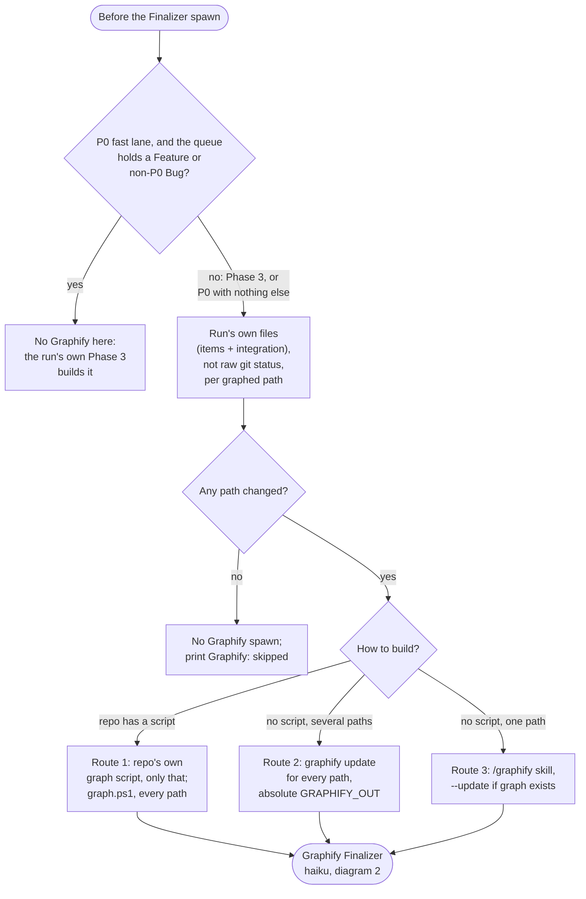
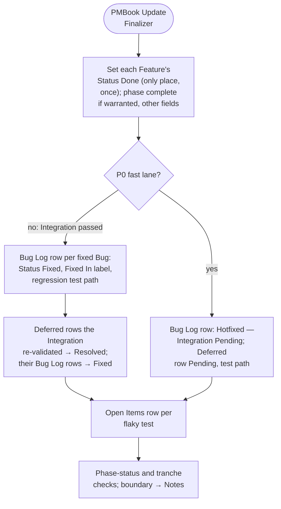

# 06 — Phase 3: Finalization

Entered when Reviewer-Integration returns PASS, or early for one P0 Bug's fast lane (07). Spikes never
reach it, and a run with no Feature and no non-P0 Bug skips it. Every Finalizer is
`orchestrated-finalizer`, with no review gate and no retry loop.

## Step 3.1 — does Graphify run, and how

Graphed paths are `graphify-directories`, or `source-code-directory` as a one-entry list; never the
project root. Route 2 runs every path when `graphify-out/graph.json` does not exist yet.

## Steps 3.1–3.6 — Release label, Finalizers, commit step, close-out

```mermaid
flowchart TD
    Label["Release label: Unreleased if<br/>changelog keeps one, else<br/>bump newest; saved as<br/>decisions phase3; print it"]
    Out["Outside items: sift; one differing<br/>from the board → Bug, unasked;<br/>offer the rest once, per surface<br/>or grouped; save decisions.outsideItemLog"]
    Gaps["Deferred minor gaps → write<br/>findings file {findings-directory}/<br/>{date}-run-{run id}.md"]
    Owed["Design rows owed: write<br/>decisions.designRowsOwed as<br/>Open rows in the open round"]
    Fork(["Spawn in one message,<br/>each with model announced"])
    subgraph Par["Parallel, disjoint files"]
        G{{"3.1 Graphify<br/>haiku, if it runs"}}
        PM{{"3.2 PMBook Update<br/>sonnet, Release label"}}
        H{{"3.3 Handoff Update<br/>sonnet"}}
        C{{"3.4 Revision + Changelog<br/>haiku, Release label"}}
        T{{"3.5 Test Runbook<br/>(+ test cases doc<br/>handoffs), sonnet"}}
    end
    Join["All spawned returned;<br/>four if Graphify skipped"]
    CM{{"3.6 Commit Messages<br/>sonnet, drafts with<br/>Run-Id and Items trailers"}}
    Staged{"git diff --cached --name-only:<br/>any staged path outside<br/>the step's file list?"}
    Stop(["Stop the step;<br/>ask the user"])
    Commit["Commit per decisions.commit<br/>(ask: ask, save answer): of the<br/>step's file list, what git status<br/>shows uncommitted, by group"]
    Notes["Surface every<br/>Finalizer's Notes"]
    Sum(["Close-out: a row per leg<br/>still without one, RUN row with<br/>commit ids from git, run-state<br/>complete; 🏁 Final summary"])

    Label --> Out --> Gaps --> Owed --> Fork --> Par --> Join --> CM --> Staged
    Staged -->|yes| Stop
    Staged -->|no| Commit --> Notes --> Sum
```

Phase 3 is one run-state unit with steps Finalizers → commit → done, each saved when it starts and ends;
a resume re-runs a `started` step from its start, which is safe because every governed-doc write updates
an existing entry for the same item (and run id and scope) instead of adding one, and the commit step
commits only what of its file list still has uncommitted changes (a group with none left is skipped).
That file list is the step's full staging set: every in-scope item's run-state `files`, the `integration`
block's `files` (changed files across every Integration pass and every Divide-and-Conquer sub-problem spawn), every Finalizer's Files Created or Modified, and run-state's
`orchestratorFiles` (every governed file the Orchestrator itself wrote); all of it reaches Commit Messages. Staged paths all inside that list are committed
with it. A "commit" said after a commit step chose `no` first sets `decisions.commit: yes` (saved), then
runs one commit pass over the union of every commit step's saved file list in the run: one code group per
item (Feature, Bug, P0) from its own `files`, `Items:` naming only it; Integration fixes outside any
item's files in their own group, `Items: integration`; governed docs, files shared by several items,
and every other file in no item's code group in one docs/chore group whose `Items:`
lists every item whose changes it holds (the graph report goes with the item it was rebuilt for; one rebuilt for the whole run goes here,
and `Items:` then lists every item in the run). Every message ends with `Run-Id: <run id>`; `Items:` names only
the items whose changes are in that commit. Commit Messages gets the Orchestrator's attribution lines
verbatim (`Attribution:`) and copies them as given, never from memory. One Commit Messages Finalizer drafts the
regrouped groups' messages first, with the trailers. The RUN row's commit ids come from
`git log --grep "Run-Id: <run id>"`, refreshed after that later "commit", and only on a row with this
run's Run ID. Every Finalizer gets `Scope: phase3` (a P0 lane's get `lane:<ID>`) and `## Final Status per Item`
(each item's final run-state status, so none is guessed from the docs). Each fixed Bug reaches PMBook Update with `Regression test: <path>`.

## Step 3.2 — what PMBook Update writes

The Orchestrator tells the user, on the final summary's `Tranche:` line, to run idea-triage's Tranche
Closeout when Notes reports every phase Done; archiving belongs to
`idea-triage`, not this step. Spike Log rows are never written here (07). The order of the writes is
drawn for reading only; the step lists them without one.
