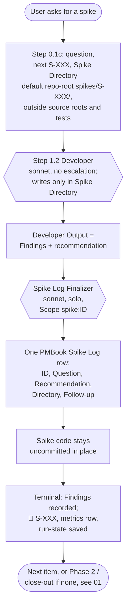
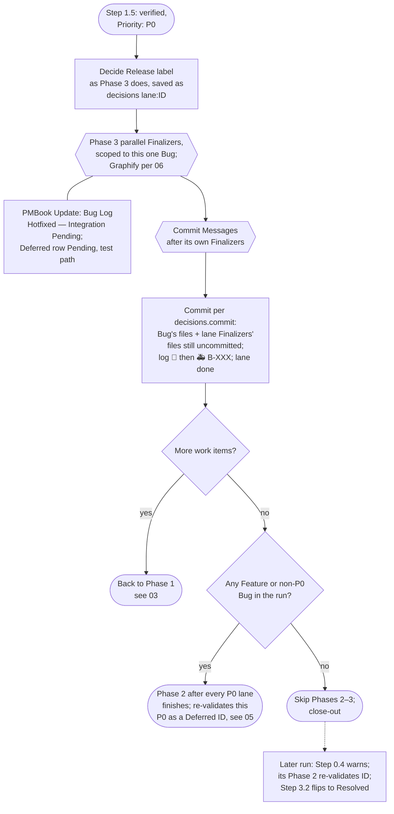

# 07 — Spike Flow and P0 Hotfix Fast Lane

Both are named exceptions to specific steps, not separate pipelines (`references/spike-and-p0.md`).

## Spike Flow

No Reviewer, retry loop, Manual Verification Gate, Integration, other Finalizer or escalation;
`loop_count` never moves. Whether the spike code is promoted or abandoned is the user's call. A
Spike-only run skips Phases 2–3 and still runs close-out. On resume, a Spike with a Developer Output
and no Spike Log goes to its Spike Log Finalizer, never a Reviewer (02).

## P0 Hotfix Fast-Lane Finalization

Graphify in the fast lane: skipped when the queue holds a Feature or non-P0 Bug (the run's own Phase 3
builds the graph); otherwise it runs before Integration — a named exception — subject to the same
no-change skip as Step 3.1. Every gate up to Step 1.5 is unchanged for a P0; only full-suite Integration
is deferred, never skipped. One PMBook writer at a time: a P0 lane's Finalizers, a Spike Log Finalizer
and another P0 lane never run concurrently; each waits for a lane, with its commit if any. The lane is a
run-state unit with steps Finalizers → commit → done, each saved when it starts and ends; a resume rejoins
a lane not `done` at its recorded step and then carries on with the remaining items (02). Its commit
step's file list is the Bug's run-state `files` plus its lane Finalizers' files, and it commits whatever of
that list `git status` still shows uncommitted; Phase 2 takes this P0's files from run-state, and commit ids
from `git log --grep "Run-Id: <run id>"` only when any exist.
