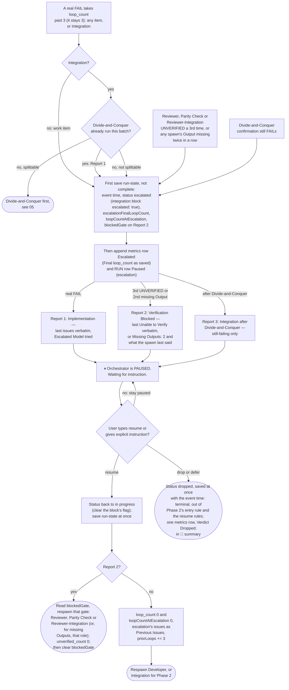

# 08 — Escalation

Three situations pause for a human (SKILL.md Escalation; `references/escalation.md`). Spike work items
never reach any of them.

A Manual Verification rejection counts as a FAIL toward `loop_count` (04), so it reaches Report 1; the
`loop_count` 3 attempt always ran on the Escalated Model, whichever kind of FAIL led there. A resumed
item gets a second metrics row at its next terminal state, whose Final loop_count is that leg's count
(09). Every row's Final loop_count, the Escalated row's included, is `loop_count` minus run-state's
`loopCountAtEscalation` (0 when never escalated), read before this escalation overwrites it. Run-state
(event time, `escalated` status, `escalationFinalLoopCount` — the Escalated row's Final loop_count, so a
re-run writes the same value — and `loopCountAtEscalation`) is saved before the rows are appended. An
explicit user "drop" or "defer" sets the item `dropped` instead of resuming it, and writes its one
metrics row (Verdict `Dropped`, Timestamp the saved event time), which close-out counts. Resuming
Report 2 leaves `loop_count`, `priorLoops` and Previous Issues as they were; a restart at `loop_count` 0
also sets `loopCountAtEscalation` to 0. The pause is not close-out:
run-state stays incomplete, and the resumed run's close-out appends a second RUN row, `Complete`.
