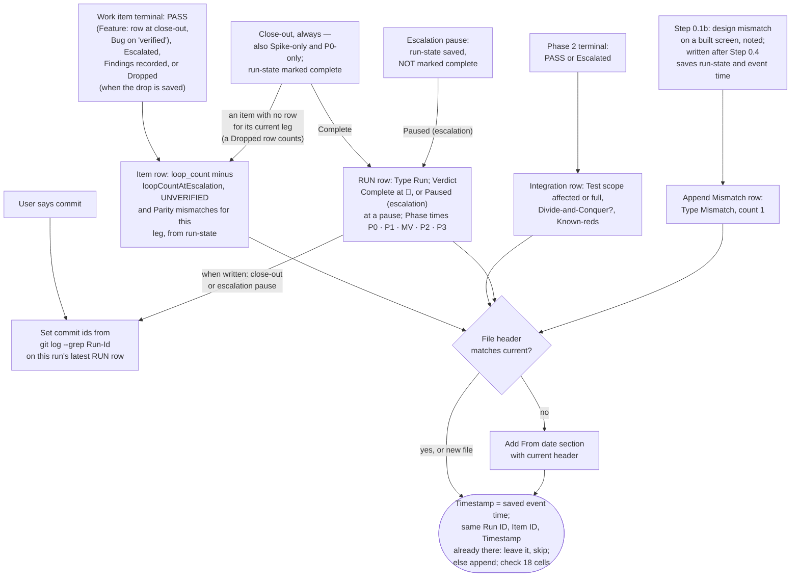

# 09 — Metrics: which event writes which row

The Orchestrator appends to `metrics-log-file` itself, never overwriting (SKILL.md Pipeline Telemetry).
Every row kind uses the same 18-cell header; `—` where a cell does not apply.

The Integration row is written only if Phase 2 ran; the RUN row always. A dropped item gets one row,
Verdict `Dropped`, when the drop is saved, using the saved event time. An Escalated row is appended at
the moment of escalation; a resumed item gets a second row at its next terminal state. A resumed run
ends with a second RUN row, `Complete`. A RUN row takes this run's commit ids from `git log --grep
"Run-Id: <run id>"` when written and after each later commit (never another run's row). Writes are
repeat-safe: every row kind takes its Timestamp from the event time saved in run-state before the row is
written (an event time already saved is reused on a re-run, never read again), and rows are write-once: a row with the same Run ID, Item ID and Timestamp already in the log is left
unchanged, so a re-run skips it (legs, Paused vs Complete and second mismatch reports have different event times, so
all survive). Final loop_count on every row (an Escalated row included) is
`loop_count` minus `loopCountAtEscalation`, 0 when never escalated; an Escalated row takes it from run-state's
saved `escalationFinalLoopCount`, so a re-run writes the same value. Stored UNVERIFIED and Parity mismatch counts are
cleared once an item's row is written, so each leg counts only its own. The RUN row's
Wave, Final loop_count, Escalated? and UNVERIFIED count are `—`, and Started / Finished are the run's
start and end. An old row takes only one edit: the RUN row's appended commit ids. A mismatch is always its own appended row.

**Step rows.** Besides the rows above, one row per step (each agent spawn, and each wait on the user,
a usage limit), appended the moment the step ends: Type `Step: <role>` or `Wait: <what>`,
Started from run-state's `steps`, Finished = Timestamp, Final loop_count = the attempt, Phase times = its
length in minutes. A step cut off is written on resume as `interrupted`. Close-out and the retry
counters ignore step rows (`SKILL.md` **Pipeline Telemetry**).
