# Orchestrator Development Pattern — Flow Diagram

```mermaid
flowchart TD
    Start([Start]) --> Init

    subgraph Phase0["Phase 0 — Initialization"]
        Init["Step 0.0: Verify hard dependencies:\nPMBook, source-code-directory,\narchitecture-doc"]
        Init -->|missing| AskUser0["Stop & ask user"]
        Init -->|present| DeferredCheck["Scan PMBook for\n'## Deferred Integration' Pending rows\n(hold — surface at Announce, never blocks)"]
        DeferredCheck --> ResumeCheck{"run-state-file exists\n& run not complete?"}
        ResumeCheck -->|Yes| AskResume["Stop & ask:\nresume incomplete run,\nor start fresh?"]
        AskResume -->|resume| RebuildQueue["Rebuild queue position\nfrom run-state-file\n(Platform Profile already persisted)"]
        RebuildQueue -.-> FeatureLoop
        AskResume -->|start fresh| TestDocCheck
        ResumeCheck -->|"No, or already complete"| TestDocCheck{"test-cases-doc\npresent?"}
        TestDocCheck -->|No| DraftTestDoc["Draft test-cases-doc now\nfrom PMBook Feature Backlog\n(standing default — no question,\nunless drafting is genuinely blocked)"]
        TestDocCheck -->|Yes, thin/stale| AskTestDoc2["Ask user: proceed as-is,\ndraft missing scenarios, or pause"]
        TestDocCheck -->|Yes, adequate| EntryFork
        DraftTestDoc --> EntryFork
        AskTestDoc2 --> EntryFork
        EntryFork{"Entry point?"}
        EntryFork -->|"Normal (0.1)"| ReadPMBook["Read PMBook:\nactive phase, features,\nacceptance criteria, dependency order"]
        EntryFork -->|"Bug Fix Intake (0.1b)\nexplicit ask, no PMBook\nrow required"| BugIntake["Take bug report from user,\nassign next B-XXX,\ndetect explicit P0 signal"]
        EntryFork -->|"Spike Intake (0.1c)\nexplicit ask, no PMBook\nrow required"| SpikeIntake["Take question from user,\nassign next S-XXX +\nSpike Directory"]
        ReadPMBook --> DetectPlatform["Detect platform\n(package.json / pyproject.toml /\ngo.mod / Cargo.toml / *.csproj)"]
        BugIntake --> DetectPlatform
        SpikeIntake --> DetectPlatform
        DetectPlatform -->|ambiguous/none| AskPlatform["Stop & ask user\nto confirm platform"]
        DetectPlatform -->|detected| DetectConventions["Detect coding conventions\n(.editorconfig, .prettierrc, etc.)"]
        AskPlatform --> DetectConventions
        DetectConventions --> Announce["Announce plan:\nplatform, phase/mode, items,\nquality gates, estimated spawns,\n⚠ Deferred Integration warning if found"]
    end

    Announce --> FeatureLoop

    subgraph Phase1["Phase 1 — Feature Loop (per feature, bug, or spike, dependency order)"]
        FeatureLoop["Generate Task Packet\n(Type: Feature, Bug, or Spike)"] --> DevAgent["Developer Agent:\nimplement + write tests\n+ Format + Lint"]
        DevAgent -->|Type: Spike| SpikeLog["Finalizer — Task: Spike Log\n(solo invocation, confined to\nSpike Directory; writes one row\nto PMBook Spike Log)"]
        SpikeLog --> MoreFeatures
        DevAgent -->|Type: Feature or Bug| RevAgent["Reviewer Agent:\nreview vs Task Packet\n(Bug: also executes the\none named regression test)"]
        RevAgent --> Verdict1{"Verdict?"}
        Verdict1 -->|FAIL| Count1{"loop_count > 3?"}
        Count1 -->|No| ReDev["Re-invoke Developer\nwith issues list\n(fix only listed issues)"]
        ReDev --> RevAgent
        Count1 -->|Yes| Escalate1["🚨 ESCALATE TO HUMAN\nPAUSE until user types\n&quot;resume&quot;"]
        Verdict1 -->|UNVERIFIED| UnvCount1{"unverified_count\n&gt; 2?"}
        UnvCount1 -->|No| FixRespawn1["Fix what's fixable,\nrespawn Reviewer unchanged\n(does NOT increment loop_count)"]
        FixRespawn1 --> RevAgent
        UnvCount1 -->|Yes| EscalateUnv1["🚨 ESCALATE TO HUMAN\n(Verification Blocked)\nPAUSE until user types\n&quot;resume&quot;"]
        Verdict1 -->|"PASS (Feature)"| MarkDone["PMBook: feature → Done"]
        Verdict1 -->|"PASS (Bug)"| MVG["🔍 Manual Verification Gate\n(Step 1.5)\nOrchestrator posts repro steps,\nPAUSES for the user"]
        MVG --> UserCheck{"User response?"}
        UserCheck -->|"user types\n&quot;verified&quot;"| PriorityCheck{"## Priority: P0?"}
        PriorityCheck -->|No| MarkDoneBug["Held for Bug Log write\nat Finalize (Step 3.2)"]
        PriorityCheck -->|Yes| P0FastLane["P0 Fast-Lane Finalization\n(5 + 1, scoped to this Bug;\nPMBook: Hotfixed — Integration\nPending + Deferred Integration row)"]
        UserCheck -->|"still broken —\nuser describes issue"| Count1
    end

    MarkDone --> MoreFeatures{"More work items\nin this run?"}
    MarkDoneBug --> MoreFeatures
    P0FastLane --> MoreFeatures
    MoreFeatures -->|Yes| FeatureLoop
    MoreFeatures -->|No| Integration

    subgraph Phase2["Phase 2 — Integration"]
        Integration["Integration Agent:\nfull test suite + fix failures\n+ security audit + E2E/smoke tests"]
        Integration --> RevInt["Reviewer-Integration Agent:\nreview Integration Output"]
        RevInt --> Verdict2{"Verdict?"}
        Verdict2 -->|FAIL| Count2{"loop_count > 3?"}
        Count2 -->|No| ReInt["Re-invoke Integration Agent\nwith issues list"]
        ReInt --> RevInt
        Count2 -->|"Yes\n(runs once)"| DivideConquer["⚙️ Divide-and-Conquer\nsplit remaining failures into\nsub-problems → parallel scoped\nIntegration sub-agents\n(Escalated Model, never commit)\n→ aggregate Resolved/Still-Failing"]
        DivideConquer --> RevIntDC["Reviewer-Integration:\nsingle confirmation pass\n(does NOT increment loop_count)"]
        RevIntDC --> VerdictDC{"Verdict?"}
        VerdictDC -->|PASS| Fork
        VerdictDC -->|FAIL| EscalateDC["🚨 ESCALATE TO HUMAN\n(Integration — scoped to\nstill-failing sub-problems)\nPAUSE until user types\n&quot;resume&quot;"]
        VerdictDC -->|UNVERIFIED| UnvCountDC{"unverified_count\n&gt; 2?\n(own budget, separate\nfrom main loop's)"}
        UnvCountDC -->|No| FixRespawnDC["Fix what's fixable,\nrespawn confirmation pass unchanged\n(does NOT increment loop_count)"]
        FixRespawnDC --> RevIntDC
        UnvCountDC -->|Yes| EscalateUnvDC["🚨 ESCALATE TO HUMAN\n(Verification Blocked)\nPAUSE until user types\n&quot;resume&quot;"]
        Verdict2 -->|UNVERIFIED| UnvCount2{"unverified_count\n&gt; 2?"}
        UnvCount2 -->|No| FixRespawn2["Fix what's fixable,\nrespawn Reviewer-Integration unchanged\n(does NOT increment loop_count)"]
        FixRespawn2 --> RevInt
        UnvCount2 -->|Yes| EscalateUnv2["🚨 ESCALATE TO HUMAN\n(Verification Blocked)\nPAUSE until user types\n&quot;resume&quot;"]
        Verdict2 -->|PASS| Fork
    end

    subgraph Phase3["Phase 3 — Finalization (5 Finalizer agents in parallel, then 1 sequential)"]
        Fork(["spawn 5 Finalizer agents\n(single message, parallel)"])
        Fork --> FinGraphify["Finalizer — Task: Graphify\n(mandatory, automatic)"]
        Fork --> FinPM["Finalizer — Task: PMBook Update\n(features/phase → Done;\nTranche boundary → Notes)"]
        Fork --> FinHandoff["Finalizer — Task: Handoff Update"]
        Fork --> FinChangelog["Finalizer — Task:\nRevision + Changelog"]
        Fork --> FinRunbook["Finalizer — Task: Test Runbook"]
        FinGraphify --> Join{{"all 5 returned"}}
        FinPM --> Join
        FinHandoff --> Join
        FinChangelog --> Join
        FinRunbook --> Join
        Join --> CommitMsgs["Finalizer — Task: Commit Messages\n(synthesizes the 5 outputs;\nDO NOT EXECUTE)"]
    end

    CommitMsgs --> Done([🏁 Orchestrator Complete])

    Escalate1 -.->|user types resume| ReDev
    EscalateUnv1 -.->|user types resume| FixRespawn1
    EscalateDC -.->|user types resume| ReInt
    EscalateUnv2 -.->|user types resume| FixRespawn2
    EscalateUnvDC -.->|user types resume| FixRespawnDC

    style Escalate1 fill:#ffcccc,stroke:#cc0000,color:#000000
    style EscalateUnv1 fill:#ffcccc,stroke:#cc0000,color:#000000
    style EscalateDC fill:#ffcccc,stroke:#cc0000,color:#000000
    style EscalateUnv2 fill:#ffcccc,stroke:#cc0000,color:#000000
    style EscalateUnvDC fill:#ffcccc,stroke:#cc0000,color:#000000
    style DivideConquer fill:#fff2cc,stroke:#d6b656,color:#000000
    style MVG fill:#cce5ff,stroke:#0066cc,color:#000000
    style RebuildQueue fill:#cce5ff,stroke:#0066cc,color:#000000
    style SpikeLog fill:#e6ccff,stroke:#7700cc,color:#000000
    style Done fill:#ccffcc,stroke:#009900,color:#000000
    style Start fill:#ccffcc,stroke:#009900,color:#000000
```

**Keywords to remember:**
- `"resume"` — clears any `🚨 ESCALATE TO HUMAN` pause (`Escalate1`, `EscalateUnv1`, `EscalateDC`, `EscalateUnv2`, `EscalateUnvDC`) — whether from 3 failed loop iterations, a Divide-and-Conquer pass that still left sub-problems failing, or the Reviewer/Reviewer-Integration hitting 3 straight UNVERIFIED verdicts (the Divide-and-Conquer confirmation pass tracks its own separate UNVERIFIED budget from the main loop's)
- `"verified"` — clears the `🔍 Manual Verification Gate` (`MVG`, Step 1.5) for a Bug packet whose regression test just passed Review; anything else typed there is read as "still broken" and sent back into the retry loop
- Finalization (`Fork`/`P0FastLane`) can now fire more than once per run — once per P0 hotfix's own fast lane, plus the normal batch-end pass at `Fork` for whatever remains
- `"resume"` is overloaded across two unrelated prompts — at `AskResume` (Step 0.0) it means "pick the interrupted run back up from `run-state-file`," distinct from the escalation-pause `"resume"` above that just un-pauses the current run. Never conflated: the Resume Check only ever fires once, at the very start of a fresh invocation, before any escalation could exist.
