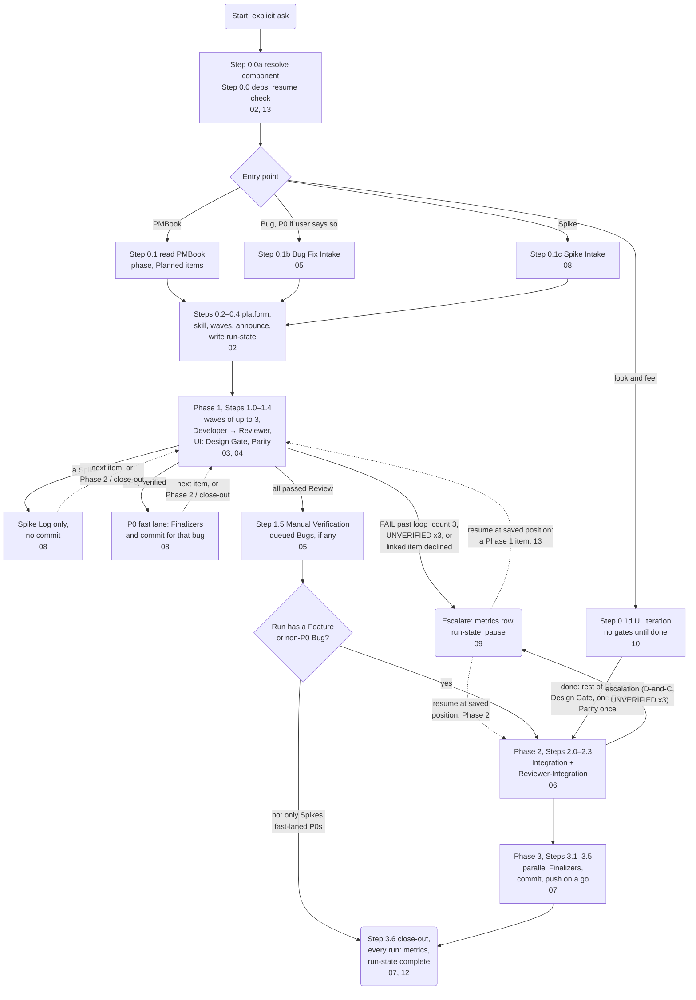

# 01 — Bird's-eye view

The whole run. Each box names its step numbers and the file that draws it in detail.
Linked Runs (two components that must land together) wrap this whole flow: see `11-linked-runs.md`.
`run-state-file` is written at every gate along the way (`13-run-state-and-resume.md`).

Nodes: 17. The UI Iteration also runs Step 1.4's retry rules for its one Reviewer, which this view
folds into the "done" edge (`10-ui-iteration.md`).

## Open questions

None.
