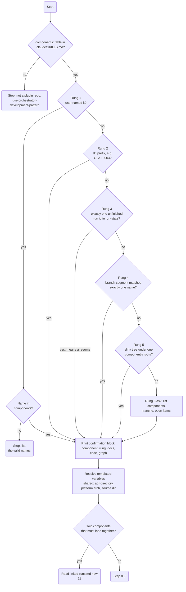
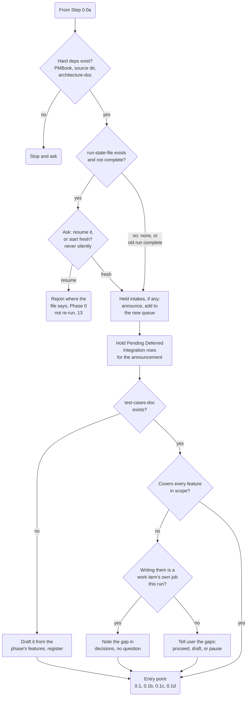
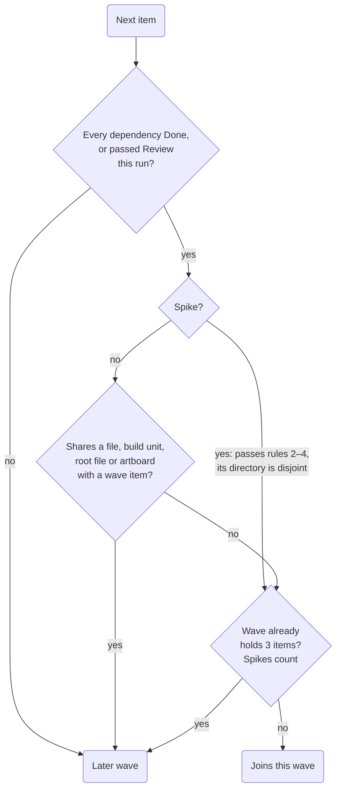

# 02 — Phase 0: setup (Steps 0.0a–0.4)

## Step 0.0a — resolve the component

The ladder stops at the first rung that resolves. There is never a default component.

Nodes: 17. Work that spans two components is always split into one item per component, linked by
`Depends on:`; the decision above is whether those items must land together. A linked item raised
mid-run runs Steps 0.0, 0.0a, 0.2, 0.3 and 0.3b for its component before its first spawn (`11`).

## Step 0.0 — dependencies and resume

Nodes: 16. Soft dependencies (handoff, changelog, revision, runbook, audit command, ADR folder,
graphify directories, run-state, metrics) are created or skipped later and never stop the run.

## Steps 0.1–0.4 — platform, skill, waves, announce

```mermaid
flowchart TD
    In("After the entry point<br/>0.1 PMBook, 0.1b Bug,<br/>0.1c Spike") --> Plat{"0.2 one clear<br/>platform marker?"}
    Plat -->|"none, or several"| AskPlat["Ask the user"]
    Plat -->|"yes"| Prof["Platform Profile:<br/>Format, Lint, Test full,<br/>Test component, audit"]
    AskPlat --> Prof
    Prof --> Stack["Record Stack line:<br/>up, down, check,<br/>static servers"]
    Stack --> Conv["0.3 Coding conventions"]
    Conv --> Skill["0.3b Specialist skill,<br/>chosen once, may be None"]
    Skill --> Hold["Design rows hold: UI item<br/>whose rows are not Done waits;<br/>no rows + new layout → write<br/>them in the open round;<br/>old layout → migration guide"]
    Hold --> Waves["0.4 Build waves<br/>Step 1.0 rules, below"]
    Waves --> Ann["Announce: full block, or<br/>one line for Bug or Spike<br/>mode, + Deferred line"]
    Ann --> UIq{"A planned packet<br/>touches a UI?"}
    UIq -->|"yes"| UIB["Read ui-packets.md,<br/>check UI bindings,<br/>look in repo, then ask<br/>once if missing<br/>04"]
    UIq -->|"no"| RS
    UIB --> RS["Fix run id, runs/ and<br/>gate-logs/ folders,<br/>write run-state-file"]
    RS --> Base["0.4b Baseline test run<br/>on the untouched tree,<br/>save baseline.reds;<br/>skipped for P0, Spike,<br/>UI Iteration, mid-run intake"]
    Base --> P1("Phase 1<br/>03")
```

Nodes: 14. The UI bindings are checked after the announcement and before Phase 1, in the order Step
0.4 lists them.

## Step 1.0 — may an item join this wave?

Waves are planned at Step 0.4 by Step 1.0's rules. When in doubt, serialize.

Nodes: 7.

## Open questions

None.
