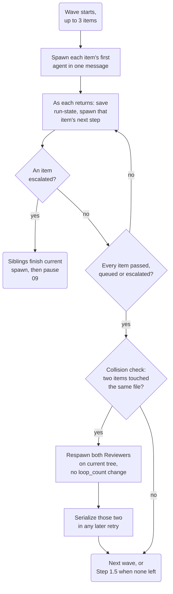
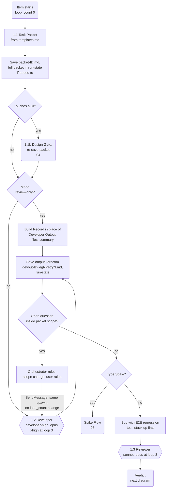
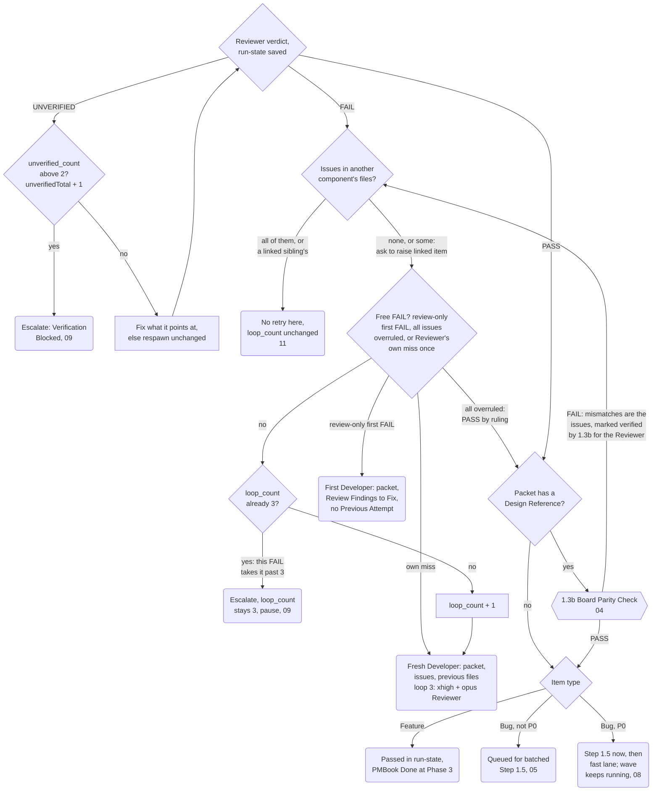
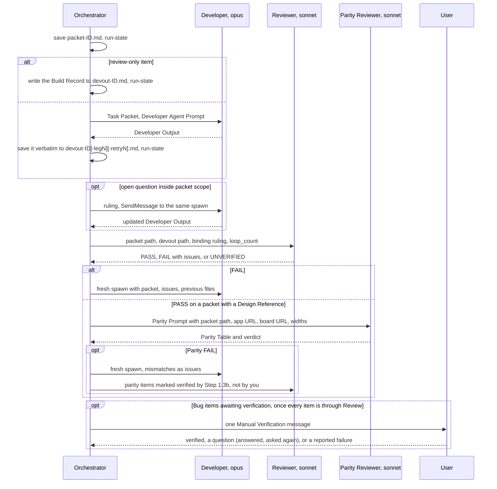

# 03 — Phase 1: the work-item loop (Steps 1.0–1.4)

## Running a wave (Step 1.0)

Nodes: 10. A P0 that passes Review takes its fast lane (`08`) while the rest of its wave keeps
running.

## One item: packet to verdict (Steps 1.1–1.3)

Nodes: 16. The Reviewer gets the packet path, the verbatim Developer Output path and any ruling,
marked binding. On a Bug it runs the one named regression test.

## Handling the verdict (Steps 1.3, 1.3b, 1.4)

Nodes: 18. UNVERIFIED never touches `loop_count`; nor does a spawn that returns no Output (one nudge,
then a respawn). The free FAILs and the overrule guard are Step 1.4's three rules, checked before the escalation check; a Reviewer's
`Outside this item` findings never enter this loop — they go to the item's `outsideItem` list. A Parity FAIL whose mismatch lies in another
component's files (e.g. the shell's theme) takes the same cross-component route as a code FAIL.

## Who sends what to whom

## Open questions

None.
