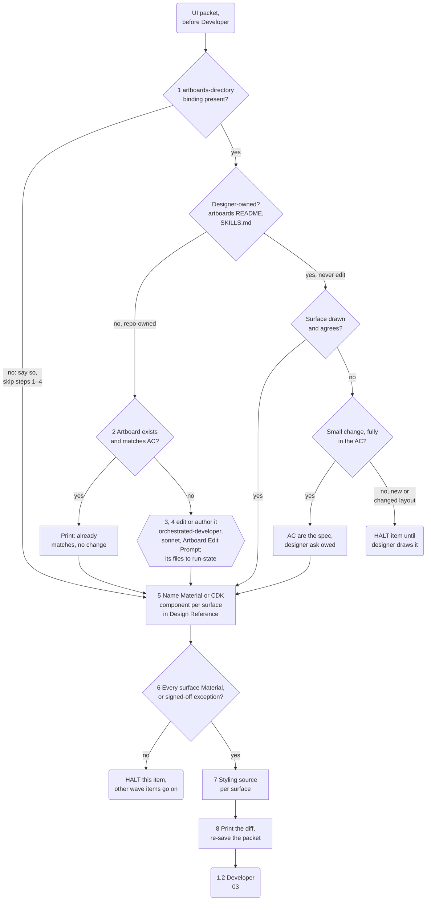
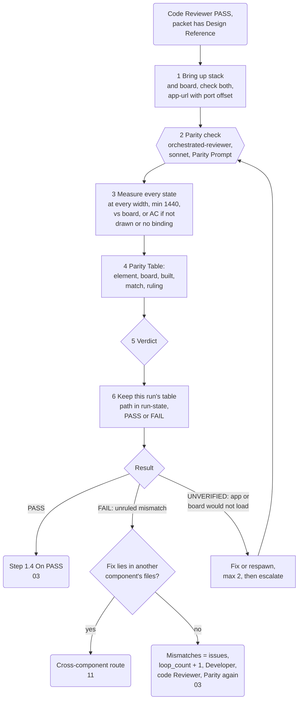

# 04 — UI packets: Design Gate and Board Parity Check

Full procedure: `references/ui-packets.md`. Before Phase 1, if `app-url` or `artboard-server` is
missing, the Orchestrator asks the user once; the Parity Check is never skipped for want of a URL.

## Design Gate (Step 1.1b) — before the Developer, never after

Nodes: 17. The designer-owned check is the exception to steps 3 and 4, so it is read before them. In
a UI Iteration this gate runs once, after the code, at "done" (`10-ui-iteration.md`).

## Board Parity Check (Step 1.3b) — after the code Reviewer's PASS

Nodes: 12. Step 1.5 attaches the latest Parity Table; the metrics row counts the unruled mismatches
across every run's table.

## Open questions

None.
