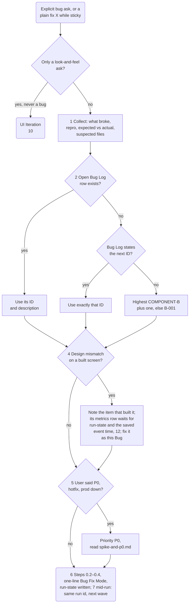
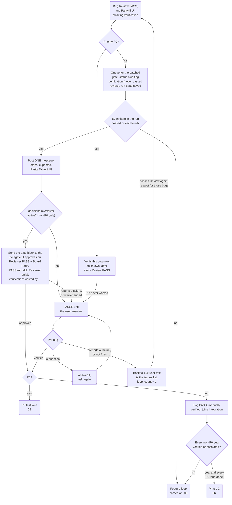

# 05 — Bug Fix Intake and Manual Verification

## Bug Fix Intake (Step 0.1b)

Nodes: 15. Several bugs at once are queued in the order given; Step 1.0 decides which share a wave.
A mid-run intake (a bug or spike while a run is open) keeps the run id and run-state file and joins
the next wave; once Phase 2 has started its packet is saved in run-state's `decisions.heldForNextRun`
and the next run's Step 0.0 announces it and puts it into its queue (whether the old run completed
or the user chose to start fresh).

## Manual Verification Gate (Step 1.5)

Nodes: 18. Only a reply that reports a failure (or says it is not fixed) is a rejection; a question
is answered and the gate asked again; a new bug is a mid-run intake, not a rejection. Rejected bugs can run as a wave. With Linked Runs, one message covers every linked run's bugs.
A verified Bug's PMBook row is written `Fixed` at Phase 3 (a P0's `Hotfixed — Integration Pending`).

## Open questions

None.
