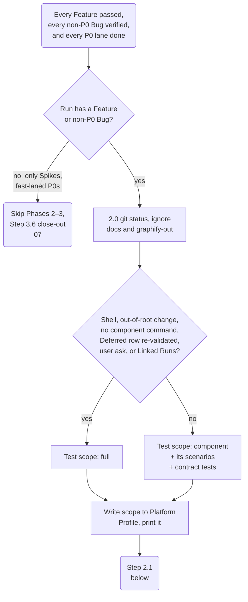
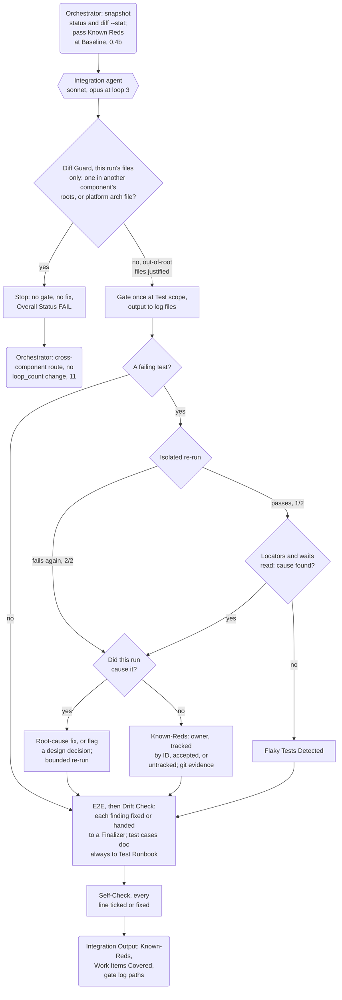
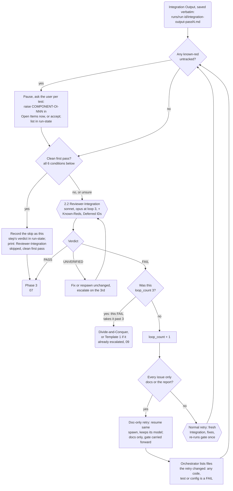

# 06 — Phase 2: Integration (Steps 2.0–2.3)

## Test scope (Step 2.0)

Nodes: 8. A P0 fast-laned earlier in this run is not a work item here, but its `Pending` Deferred row
is passed for re-validation, which forces `full`.

## The Integration agent (Step 2.1)

The order the agent works in, from `orchestrated-integration.md`'s Core Workflow.

Nodes: 16. The Diff Guard checks only this run's files (Developer Outputs, a UI Iteration's file set, its
own fixes); any other dirty path is listed `not this run's`, never a FAIL. An out-of-root file passes
only when the prompt's `Out-of-root files` line gives its justification. A known-red named in the
prompt's `## Accepted Known-Reds` keeps the agent's own owner and takes its status from that line. Flaky tests and known-reds are reported,
never passed silently; the agent never invents a tracking ID.

## Reviewer-Integration and the loop (Steps 2.2, 2.3)

Nodes: 16. A retry, a pass resumed after escalation, or a pass re-run after a crash is never a skip candidate:
Reviewer-Integration always checks it. It gets the Integration Output as its saved file's path (Step 2.1;
a Divide-and-Conquer sub-problem's file has `-sub<K>`), never a summary; a background spawn's task output
file is a transcript, never the Output. It also gets `## Deferred Integration` (the Step 2.1 IDs, or `None`). The untracked
known-red pause comes before every Reviewer-Integration spawn, retries and Divide-and-Conquer included,
and every later Integration spawn gets the ruled list as `## Accepted Known-Reds`.

The six skip conditions (Step 2.2), all mechanical:

1. First pass (`loop_count` 0, not a resume after escalation, not a pass re-run after a crash) and Overall Status `PASS`.
2. `Fixes Applied` is `None`, and `git status --porcelain` and `git diff --stat` match the Step 2.1
   snapshot (apart from a tracking item raised at the pause). Drift handed to a Finalizer (the test
   cases doc's always is) is not a fix.
3. The gate ran this pass at the set Test scope, the counts match each gate log's summary line, and
   every failure in the log is under `Known-Reds` or `Flaky Tests Detected`.
4. Every Self-Check line ticked; `Flaky Tests Detected` and `Unresolvable Issues` are `None` (apart from
   a recorded E2E skip for a missing test-cases doc).
5. Each known-red passes a quick look: `tracked by` an ID that starts an open `## Open Items` row's
   Item cell in the owner's live PMBook, or
   `accepted by the user` on the accepted list, the status matching its ruled line, and its file under
   the owner the agent named.
6. `Work Items Covered` names every Feature and Bug passed as this run's, each `PASS`, and no Deferred
   Integration ID (those sit only under `Deferred Integration Re-Validated`).

## Open questions

None.
