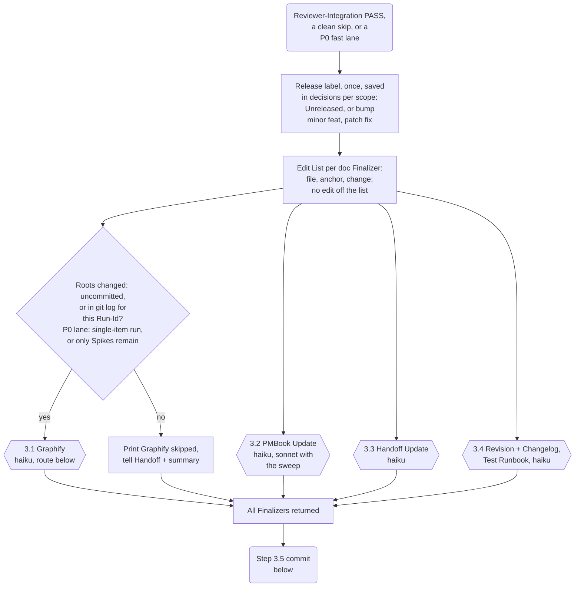
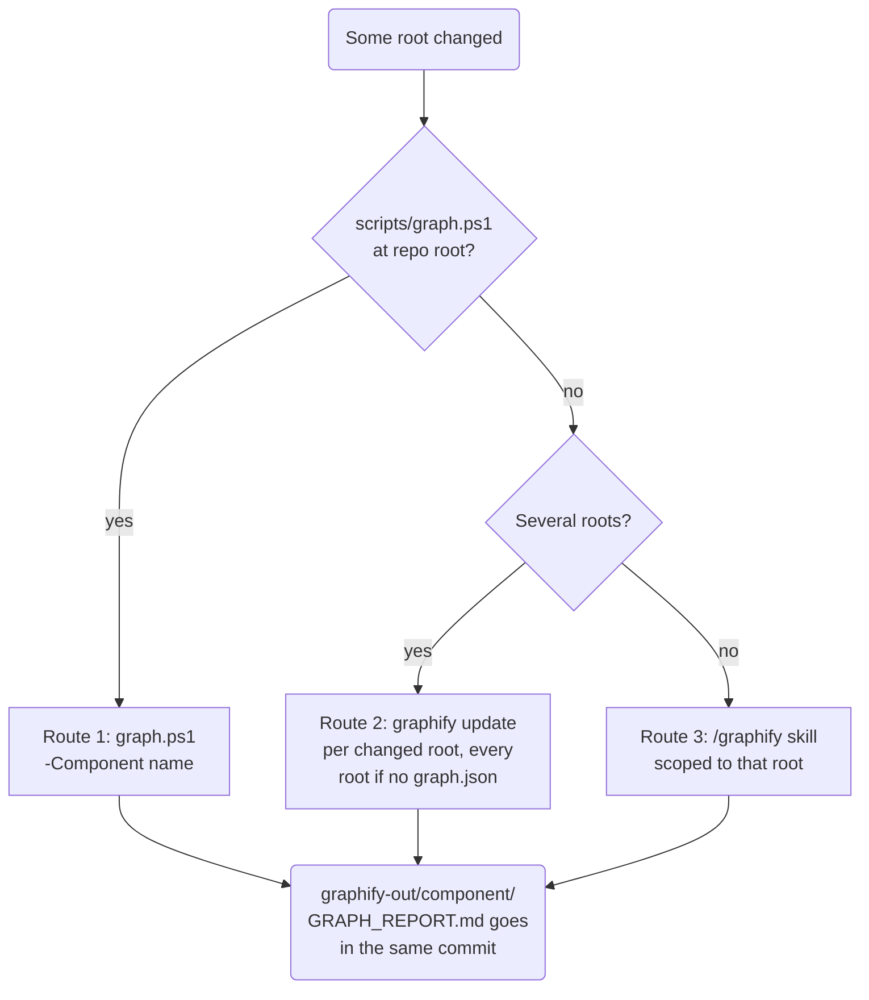
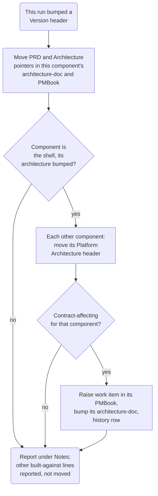
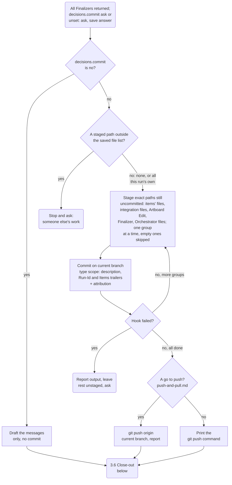
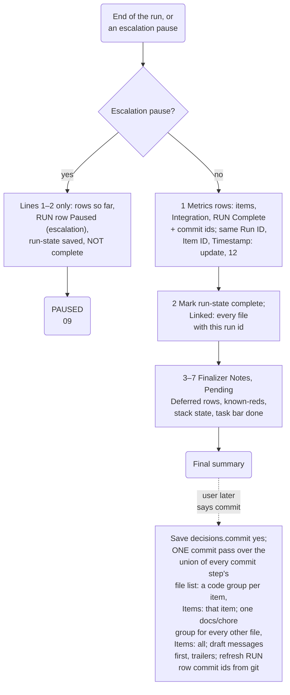

# 07 — Phase 3: Finalization (Steps 3.1–3.6)

## The parallel Finalizers (Steps 3.1–3.4)

Nodes: 11. The spawns (four, or three when Graphify is skipped) go in one message and write disjoint
files. The PMBook and Changelog Finalizers both get `Release label:`; the PMBook one also gets
`P0 fast lane: <B-ID>, Hotfixed On <date>` when relevant and the `Deferred Integration Re-Validated`
list (those Deferred rows → `Resolved`, their Bug Log rows → `Fixed`). The PMBook Finalizer always
does its own phase-status, open-item and tranche-boundary checks, and is the only place a Feature
becomes `Done`. A Spike gets only its Spike Log (`08`).

## Graphify route (Step 3.1)

Nodes: 6. Always before the commit, never after; one graph per component.

## Version Pointer Sweep (inside 3.2, only when a version header moved)

Nodes: 7.

## Commit (Step 3.5)

Nodes: 13. Linked Runs: one commit group per component, the depended-on one first. A Spike's code and
a run that ended escalated or paused are never committed. The file list, kept in run-state, is the
step's full staging source set: every in-scope item's `files` (every attempt), the `integration`
block's `files` (every Integration pass and Divide-and-Conquer spawn), the Artboard Edit files, every Finalizer's files and run-state's
`orchestratorFiles` (every governed file the Orchestrator wrote). A commit step commits whatever of that list `git status` still shows uncommitted,
grouped as usual; a group with nothing
left uncommitted is skipped. Staged paths all in that list are this run's own and are committed; only
a staged path outside it stops the step. A resumed commit step does the same, and asks again on
`decisions.commit: ask` (or unset).

## Close-out (Step 3.6) — every run

Nodes: 8. A "commit" said after a commit step chose `no` first saves `decisions.commit: yes`, then runs
one commit pass over the union of every commit step's saved file list in the run, grouped as Phase 3
groups are: each item (Feature, Bug, P0) gets its own code group from its own `files`, `Items:` naming
only that item; every other file — governed docs, a file shared by more than one item, and any file in
no item's code group (an Integration fix outside every item, the graph report) — goes in one docs/chore
group whose `Items:` lists every item. The Orchestrator drafts the regrouped messages first, with the trailers. Refreshing the
commit ids is the second edit an old metrics row may take.
Line 4 also lists any `heldForNextRun` item; the next run's Step 0.0 queues it. The close-out runs once, at the end of the run — a
Spike-only or P0-only run, and one that skipped Phases 2–3, included. A P0 fast lane inside a
multi-item run does not run it.

## Open questions

None.
