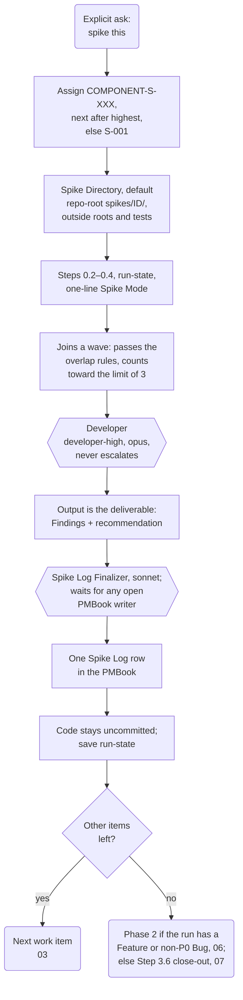
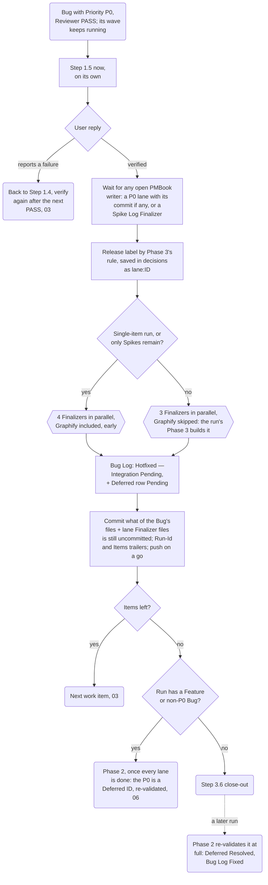

# 08 — Spike Flow and P0 fast lane

Full procedure: `references/spike-and-p0.md`. Both need the user to actually say so; never inferred.

## Spike (Step 0.1c and the Spike Flow)

Nodes: 12. No Reviewer, retry loop, Manual Verification, Integration or escalation; `loop_count`
never moves.

## P0 hotfix fast lane

Nodes: 17. A question in reply is answered and the gate asked again. The close-out runs once, at the
end of the run, and writes the P0's metrics row there; the 🏁 summary prints each P0's status as it
stands after Step 3.2. The lane's steps (`finalizers → commit → done`) are saved as each starts and
ends; a resume re-runs a step found `started`, and a re-run commit step skips a group with nothing
left uncommitted (`git status`; no git-log check). Graphify's change check counts a root changed when it
has uncommitted changes or a file in `git log --grep "Run-Id: <run id>" --name-only`.

## Open questions

None.
