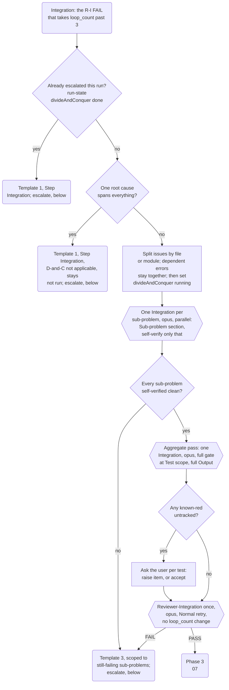
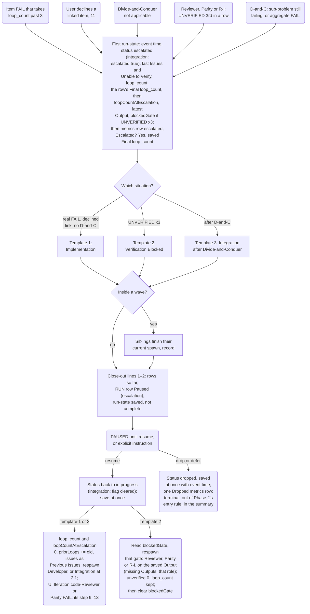

# 09 — Escalation and Divide-and-Conquer

Full templates: `references/escalation.md`. A Spike never reaches any of this.

## Divide-and-Conquer — the last attempt for Integration

Nodes: 14. Every sub-problem and the aggregate pass get the run's `## Accepted Known-Reds`.
Divide-and-Conquer runs only on the FAIL that takes loop_count past 3, and never again once it has
escalated. Run-state's `integration.divideAndConquer` records its stage (`running` only once the split
succeeds, `confirmation pass` at the aggregate pass, then `done` when it decides or escalates); a "not
splittable" escalation leaves it `not run`. A crash resumes it: `running` re-runs the aggregate pass,
`confirmation pass` respawns its Reviewer-Integration. Its resolved
sub-problems are recorded in the Integration Output, never committed. When it does not apply, the
Integration metrics row's `Divide-and-Conquer triggered?` is `No (one root cause)`.

## Escalating, pausing and resuming

Nodes: 19. Integration has no wave, so its escalations take the "no" edge. A Verification Blocked
resume keeps `loop_count` and `priorLoops`. Every metrics row, the escalation row included, has Final
loop_count = `loop_count` minus `loopCountAtEscalation` (0 when never escalated); the escalation saves it in run-state first, so a re-run writes the same value. The resumed run, when it finishes, adds a `Complete` RUN row. A declined linked item
with a retry in flight escalates once that retry returns.

## Open questions

None.
