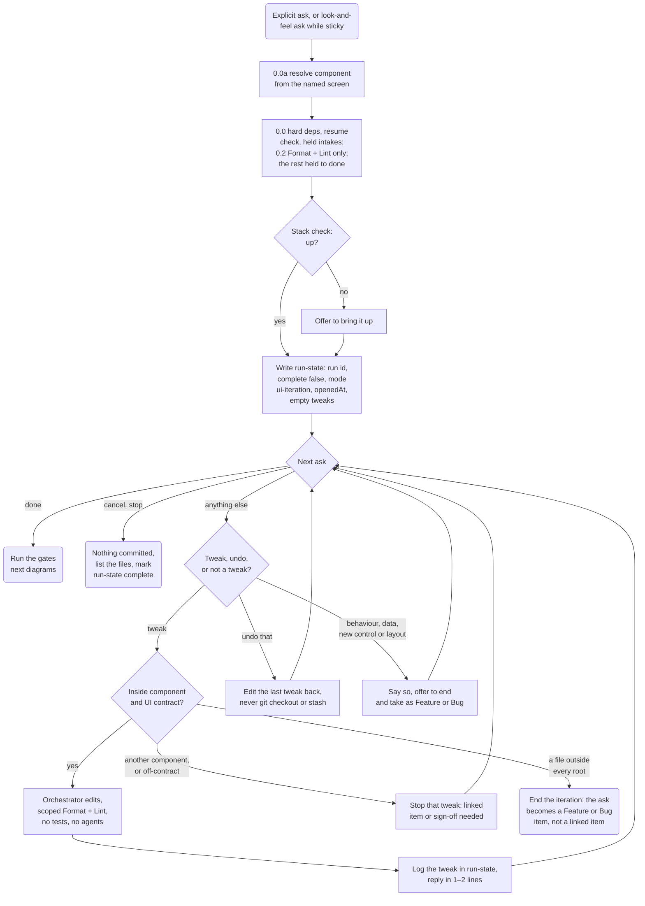
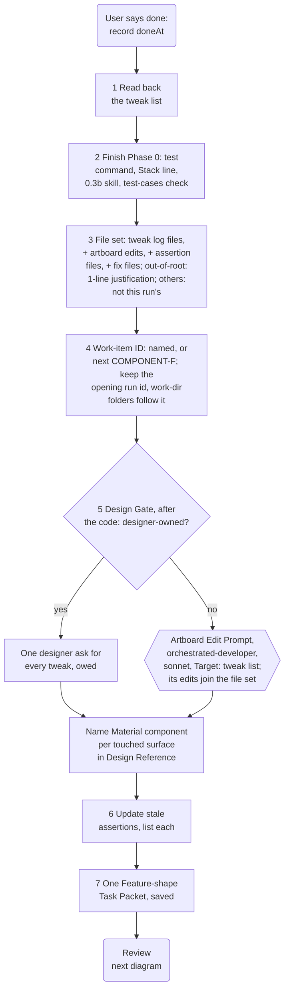
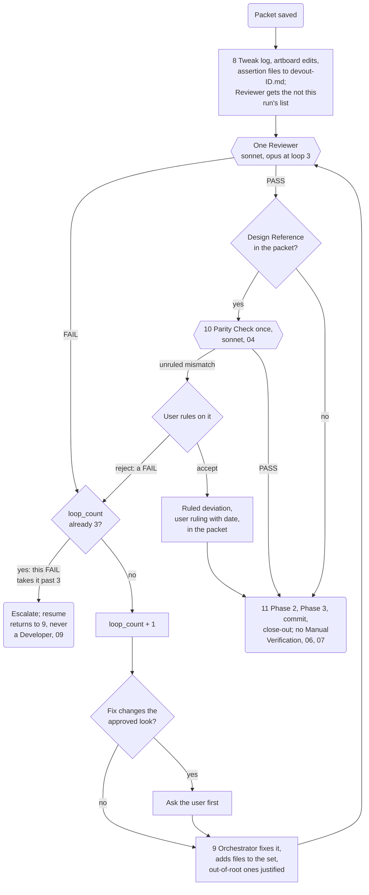

# 10 — UI Iteration (Step 0.1d)

Small look-and-feel tweaks with no gates per tweak; the gates run once at "done".
Full procedure: `references/ui-iteration.md`.

## Opening and the tweak loop

Nodes: 17. On resume before `doneAt`, ask: keep iterating, or call done? After `doneAt`, rejoin the
"done" steps where they stopped. No work-item ID is taken until "done"; the run id is written at
opening, with `"complete": false`, so the component ladder's run-state rung finds it.

## "done", part 1 — finish Phase 0 and settle the design

Nodes: 11.

## "done", part 2 — review, parity, the rest of the pipeline

Nodes: 14. UNVERIFIED follows Step 1.3's rule, as for any Reviewer. The PMBook Finalizer adds the
item's row already `Done`, with the tweak list as its criteria.

## Open questions

None.
