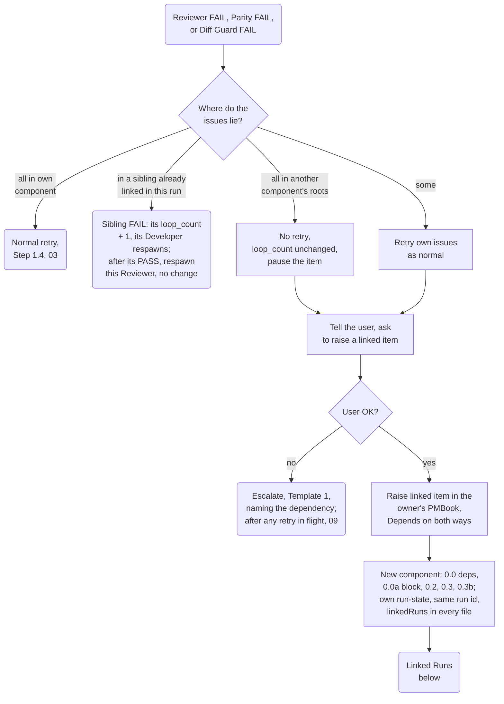
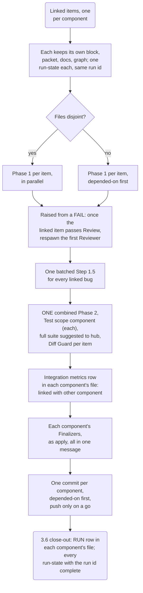

# 11 — Cross-component FAIL and Linked Runs

Full procedure: `references/linked-runs.md`.

## A FAIL in another component's files (Steps 1.4, 1.3b, 2.1)

Nodes: 12. Issues tagged `[cross-component: <owner>]` by the Reviewer (only for files in another
component's roots) count as lying elsewhere; a file outside every root is a justified-deviation check. A
Diff Guard FAIL's files go to the linked item, and Step 2.1 re-runs once it passes Review.

## Linked Runs through the phases

Nodes: 11. The Reviewer respawn after the linked item passes does not increment `loop_count`. On
resume, finding any incomplete run-state file resumes every file with that run id.

## Open questions

None.
