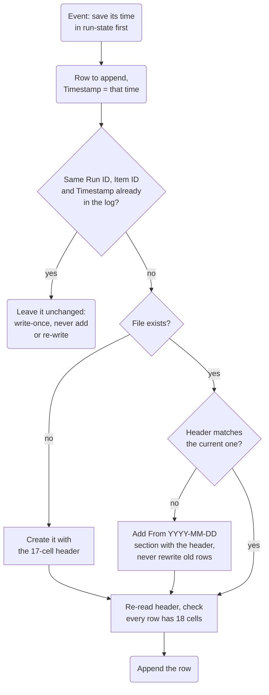

# 12 — Metrics rows

`metrics-log-file` is appended by the Orchestrator — at Step 3.6, at the moment of an escalation or a drop,
and at Bug Fix Intake for a mismatch — never overwritten. Every row has the same 18 cells; `—` where a
column does not apply.

## Which event writes which row

```mermaid
flowchart TD
    Ev1("Item terminal at close-out:<br/>verified, passed review,<br/>findings recorded") --> Item["Item row: Wave, loop_count<br/>minus loopCountAtEscalation,<br/>UNVERIFIED = unverifiedTotal,<br/>Parity mismatches: sum of<br/>run-state counts; both<br/>cleared once the row<br/>is in the log"]
    Ev2("Item or Integration<br/>escalates") --> EscRow["Save event time and<br/>escalated status to run-state,<br/>then the row: escalated,<br/>Escalated? Yes, same<br/>loop_count rule"]
    Ev3("Resumed escalated item<br/>or Integration, next<br/>terminal state") --> Item2["Second row,<br/>same rules"]
    Ev4("Phase 2 ran") --> IntRow["Integration row: Test scope,<br/>Divide-and-Conquer, Known-reds,<br/>R-I skipped, doc-only retries"]
    Ev5("Linked Runs") --> Comb["Integration and RUN rows<br/>in each component's file:<br/>linked with other component"]
    Ev6("Close-out, end<br/>of every run") --> RUN["RUN row: Complete + this<br/>run's commit ids from git log<br/>for its Run-Id; Phase times<br/>P0, P1, MV, P2, P3"]
    Ev7("Escalation pause") --> RUNp["RUN row Paused (escalation);<br/>run-state not complete; resumed<br/>run adds a Complete RUN row"]
    Ev9("User says commit<br/>after the summary") --> RUNc["Refresh commit ids from<br/>git in this run's RUN<br/>row, same run id only"]
    Ev8("Bug Intake: design<br/>mismatch on a built screen,<br/>written once Step 0.4 saved<br/>run-state and event time") --> Mm["Append a Mismatch row:<br/>count 1, other cells dash"]
    Ev10("Item dropped or<br/>deferred, drop saved<br/>with its event time") --> DropRow["One row, Verdict Dropped,<br/>Timestamp the saved time;<br/>close-out counts it"]
```

Nodes: 20. Rows are write-once: the only edit an old row takes is this run's RUN row's commit ids. A run paused on escalation writes rows for items already terminal, the escalated item's
row, the Integration row only if Phase 2 ran, and the `Paused (escalation)` RUN row; a resumed run
that completes adds its own `Complete` RUN row. A UI Iteration item's row has
`Type: Feature (UI Iteration)`, Started = `openedAt`, and its RUN row has `MV` = `n/a`.

## Appending a row

Nodes: 10. One rule for every row kind. Legs, second escalations, second mismatch reports and the
`Paused` and `Complete` RUN rows have different event times, so all survive; a re-run finds its own
row and skips it. The one exception: the RUN row's commit-ids cell is refreshed after a commit
(`SKILL.md` **Pipeline Telemetry**).

## Open questions

None.
