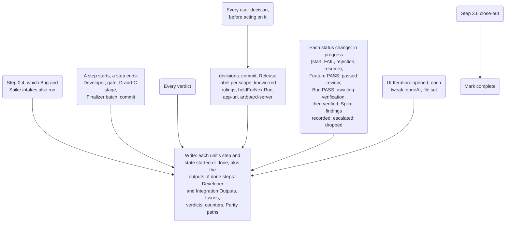
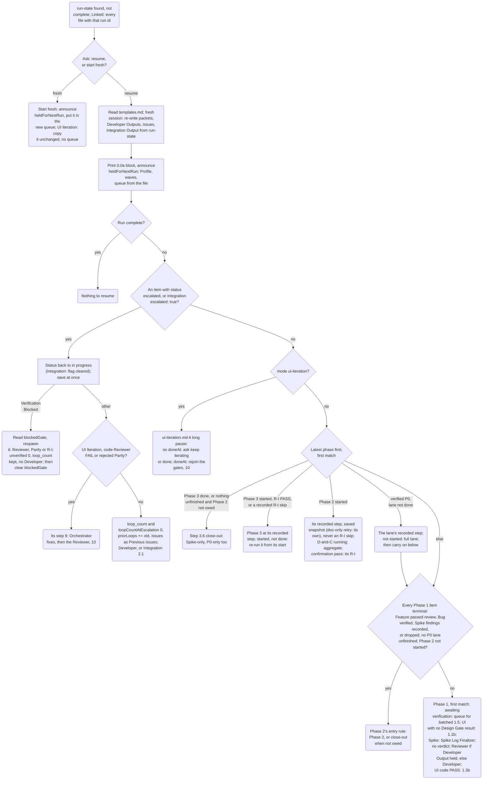

# 13 — Run-state and resume

`run-state-file` lets a fresh session resume. Full rules: `SKILL.md` **Run-State Checkpointing**
(what is saved, and when) and `references/resume.md` (where a resumed run rejoins).

## When it is written

Nodes: 10. A unit is a work-item attempt, a P0 lane, Phase 2 or Phase 3; a P0 lane's and Phase 3's steps
are `finalizers → commit → done`; a `done` Finalizers step keeps the commit step's file list (Step
3.5: in Phase 3 every in-scope item's `files`, the `integration` block's `files`, Artboard Edit and Finalizer files and
run-state's `orchestratorFiles`, each governed file the Orchestrator writes, appended when written; in a P0 lane that Bug's `files` plus its lane Finalizers' files).
Each item keeps `files`, the union of its Developer Outputs' files over every attempt. The file also holds the run id, the component, the Platform Profile,
Step 0.3's conventions summary, the waves and queue, timestamps (ISO, with the zone, read from the clock),
`linkedRuns`, and in full every packet that is not an unchanged PMBook item. Commits are not recorded
here: each message carries `Run-Id:` and `Items:` trailers, and `git log --grep "Run-Id: <run id>"`
gives the RUN row's commit ids, Step 3.1's roots and Deferred evidence; a commit step itself commits
what of its saved file list `git status` still shows uncommitted. Every governed-doc write updates an
existing entry for the same item (and run id and scope, `lane:<ID>` or `phase3`) instead of adding a second, and a metrics row with the same
Run ID, Item ID and Timestamp (the event time saved in run-state first) is left unchanged (rows are
write-once), so a re-run step is safe; a re-run reuses an event time already saved, never reading the clock again. The
`integration` block keeps Step 2.1's tree snapshot (and a doc-only retry's own "before" snapshot,
reused if that retry re-runs after a crash) and `files`, the union of changed files across every
Integration pass and Divide-and-Conquer sub-problem spawn.

## Resuming

Nodes: 23. Phase 0 is not re-run. An escalation pause is caught right after "run complete", then an
open UI Iteration, both before the phase order. A Step 2.2 skip is recorded in run-state as that step's verdict. A P0 lane is not a first-match stop: once it is done the resume
carries on with the remaining items. A complete run-state's `heldForNextRun` items are queued the same way
by the next run's Step 0.0. A re-run commit step obeys `decisions.commit` (`ask` or unset: ask again,
save the answer) and commits what of its saved file list is still uncommitted. A Spike with a Developer
Output and no Spike Log row gets its Spike Log Finalizer, never a Reviewer. Only a
Divide-and-Conquer escalation stops a second one in the run. A UI packet whose `app-url` or
`artboard-server` is missing asks for it again before Step 1.3b. Other items already terminal stay as
they are; a `dropped` item (the user's explicit "drop" or "defer", saved at once) is terminal and
never rejoined, and Phase 2's entry rule leaves it out. A PMBook item persisted by ID re-derives its packet from the current PMBook and the saved
conventions summary.

## Open questions

None.
