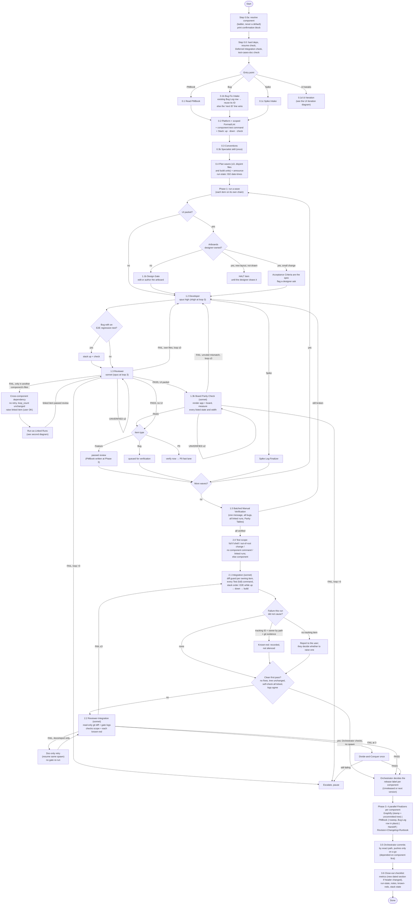
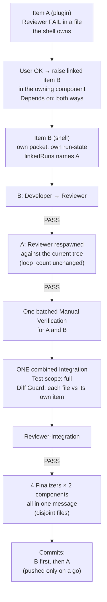
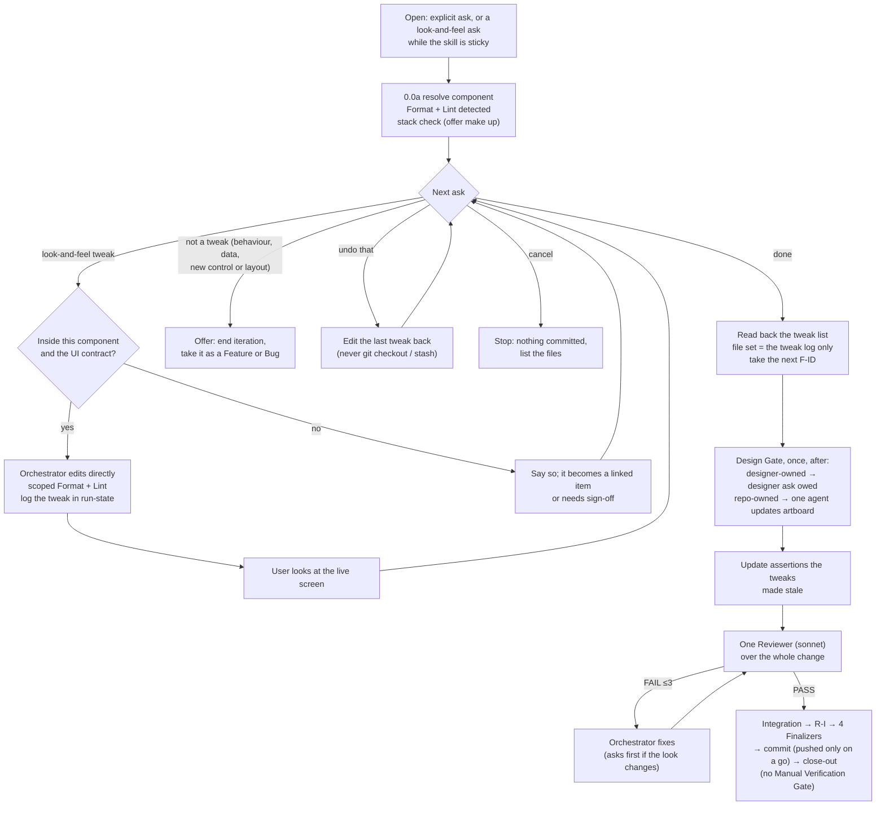

# Plugin Orchestrator Development Pattern — Flow Diagram

Reference only; `SKILL.md` is the source of truth. Updated 2026-11-10 for v1.9.0 (Board Parity Check, Step 1.3b). Earlier, 2026-11-06 for v1.4.0 (push and pull allowed on a go from the user or a hub session). Earlier, 2026-11-03 for v1.3.0 (UI Iteration, third diagram). v1.2.0 added (linked runs, the
cross-component-dependency FAIL path, known-red failures, the stack lifecycle, the release label decided
before Phase 3, designer-owned artboards, the Orchestrator commits by itself and never pushes). v1.1.0 added waves, batched manual verification, test scope,
four Finalizers and Orchestrator-drafted commit messages.

## Main flow

## Linked Runs

Two components' items that must land together — one breaks without the other. Each item keeps its
own component, docs, run-state file and graph; the Integration is shared.

## UI Iteration (Step 0.1d)

Small look-and-feel tweaks with no gates per tweak; the gates run once at "done".
Full procedure: `references/ui-iteration.md`.

